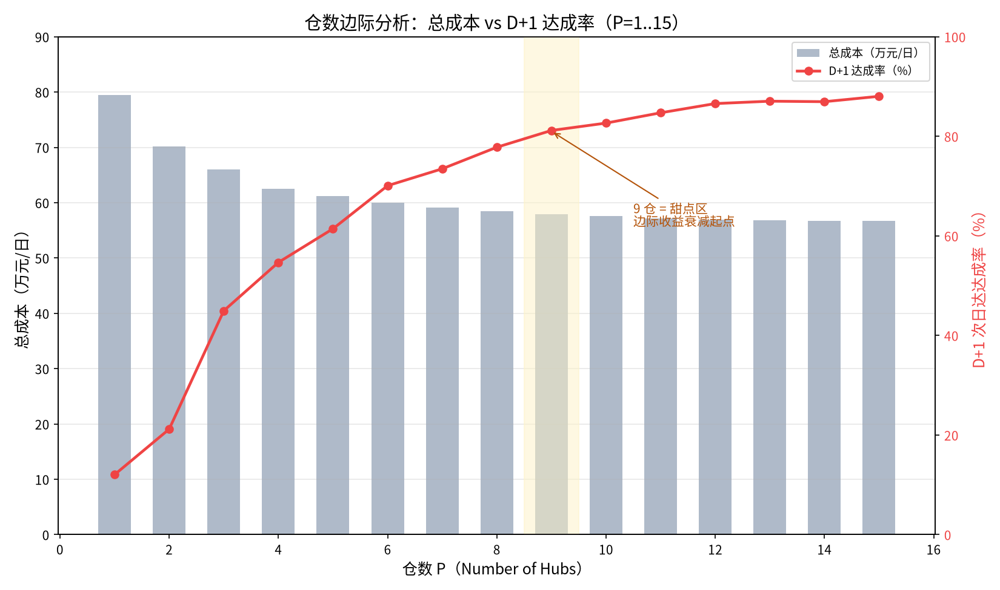
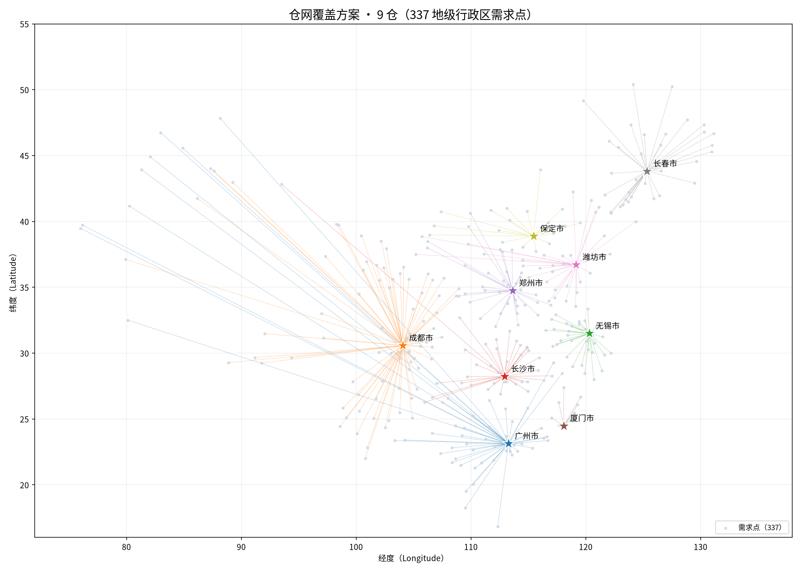

# 供应链网络设计 · 仓网规划与优化建模

**Supply Chain Network Design — Warehouse Network Planning & Optimization**

> 一个基于 **P-中值选址模型（P-Median Model）** 的全国仓网规划独立研究项目：用 Python + 高德开放数据（AMap API）+ 混合整数规划，量化回答「**几个仓、放哪里、覆盖谁、成本时效怎么权衡**」。

---

## 📌 项目一句话

> 结合城市群与交通骨架，以公开路网数据搭建 **337 个地级行政区 × 15 个候选仓** 的 P-中值选址模型，统筹仓储、补货与配送成本，纳入分级时效与容量约束，为仓数选择、仓址确定及覆盖分配提供**可复算的量化依据**。

---

## 🎯 研究问题（Research Question）

基于既往分仓实践经验，研究**不同仓数下（P 取不同值）的成本、时效与覆盖表现**：

- 仓数从 1 到 N，**总成本（仓储 + 补货 + 配送）** 如何变化？
- 增加一个仓，**边际成本** vs **时效收益** 是否划算？
- 哪些城市应被哪个仓覆盖？次日达（Next-day Delivery）达成率能到什么水平？

目标：为「单仓发全国」vs「多仓分区域」的仓网决策，提供数据与模型支撑，而非拍脑袋。

**项目全景**：337 个需求点（333 地级行政区 + 4 直辖市）× 15 个候选仓 × 60,164 单/日，双轨求解（Excel + OpenSolver / Python + CBC）交叉验证。完整方法论（建模逻辑、求解过程、六步实施法、变种场景）见 **[docs/methodology.md](docs/methodology.md)**。

---

## 🧮 方法与模型（Method & Model）

| 环节 | 方法 | 说明 |
|---|---|---|
| 空间骨架 | 城市群 + 交通骨架 | 4 极 8 组群 9 组团的空间分层，先定格局再定细节 |
| 数据获取 | Python + 高德 API（AMap API） | 拉取 337 个地级行政区的经纬度、城间距离与行车耗时 |
| 选址模型 | **P-中值模型（P-Median）** | 给定候选仓集合，选定 P 个仓使「需求点 → 最近仓」的加权运输成本最小 |
| 约束条件 | 分级时效 / 次日达达成率 / 容量 | 指定城市分级时效目标、整体次日达达成率下限、候选仓容量上限 |
| 成本统筹 | 仓储 + 补货 + 配送 | 不只算运费，把固定仓储成本与补货成本纳入比选 |
| 求解工具 | Excel + OpenSolver（对照验证） / Python（本仓复现） | 双轨求解，交叉验证结果可信度 |

### P-中值模型数学表达（Model Formulation）

```
minimize   Σᵢ Σⱼ dᵢⱼ · wᵢ · xᵢⱼ
subject to
           Σⱼ xᵢⱼ = 1                    ∀ i          # 每个需求点被且仅被一个仓覆盖
           xᵢⱼ ≤ yⱼ                       ∀ i, j       # 需求点只能分配给已开设的仓
           Σⱼ yⱼ = P                                 # 恰好开设 P 个仓
           Σᵢ wᵢ · xᵢⱼ ≤ Capⱼ             ∀ j          # 容量约束（可选）
           xᵢⱼ, yⱼ ∈ {0, 1}                           # 0-1 决策变量
```

其中：`i` 需求点（地级行政区）、`j` 候选仓、`wᵢ` 需求量/权重、`dᵢⱼ` 距离或成本、`P` 仓数、`Capⱼ` 容量。

---

## 📋 数据来源与假设（Data & Assumptions）

> 原则：**公开数据做骨架，经验参数做假设，口径可审计、可复算**。完整口径与字段说明见 [docs/data-dictionary.md](docs/data-dictionary.md)。

| 数据 | 来源 / 假设 | 说明 |
|---|---|---|
| 337 需求点经纬度 | 高德 API 地理编码（Python 批量） | 333 地级行政区 + 4 直辖市 |
| 5,055 条城间运距 | 高德 API 距离测量（Python 批量） | 需求点 → 候选仓 |
| **15 候选仓** | **19+2 城市群框架**（《国家综合立体交通网规划纲要》[gov.cn](https://www.gov.cn/gongbao/content/2021/content_5593440.htm)） | 4 极全覆盖 + 8 组群全覆盖 + 9 组团选 1（太原） |
| 需求量 60,164 单/日 | **2025 年城市 GDP 占比拟合** | 单量 Top10 与 GDP 排名一致 |
| 时效梯度 | **从业经验按运距四档**：≤450km→D+1 / 450-1300→D+2 / 1300-2200→D+3 / >2200→D+4 | 已用 5,055 条 SLA 数据佐证 |
| 时专（专属时效） | 沪/京/深/渝/广/苏 6 城**强制 D+1** | 分级时效硬要求 |
| 配送成本 | 按运距五档单均价（6~22 元/单） | 简化口径（未拆订单类型/公斤段） |
| 补货成本 | 0.35kg × 补货运距单价（0.8~2.2 元/kg） | 总仓（深圳）→ 候选仓干线 |
| 仓储成本 | 单均固有分摊 0.25/0.28/0.30 + 操作费 1.8 元/单 | 按仓分档 |

---

## 📊 结果（Results）

基于 **337 个地级行政区需求点 × 15 个候选仓** 的真实求解（Python + CBC 求解器，双轨复现 Excel + OpenSolver）：

### 核心结论：9 仓是成本—时效权衡的甜点区

| 仓数 P | 总成本（元/日） | D+1 达成率 | 边际成本（相对 P-1，元/日） | 说明 |
|---|---|---|---|---|
| 2 | 701,762 | 21.2% | — | 单/双仓配送成本高企 |
| 5 | 612,017 | 61.4% | -13,582 | 时效快速爬升段 |
| **9** | **579,082** | **81.2%** | **-5,493** | **甜点区：成本与时效平衡点** |
| 10 | 575,533 | 82.6% | -3,549 | 边际收益开始衰减 |
| 12 | 569,724 | 86.6% | -2,269 | 边际递减明显 |
| 15 | 567,155 | 88.0% | -396 | 全候选仓，边际趋零 |

- **交叉验证**：Python（CBC）9 仓解 579,082 元/日 vs Excel（OpenSolver）579,165 元/日，**误差 0.014%**，双轨一致。
- **9 仓方案**（广州/成都/无锡/长沙/郑州/厦门/潍坊/长春/保定）：仓储 124,882 + 补货 31,166 + 配送 423,118 = **579,165 元/日**，较 **2 仓业务初始方案（北京+广州）948,329 元/日降低 38.9%**，D+1 达成率由 7.3% 提升至 **82.8%**。
  > 注：表中 P=2 的 701,762 元/日/21.2% 是**数学最优的 2 仓组合**（扫描求解）；948,329 元/日是**业务直觉方案**（北京+广州）——两者口径不同，后者用于「直觉 vs 算法」对比叙事。
- **边际收益递减**：P 从 1→5 每加一仓平均省约 4.6 万元/日（时效快速改善）；P 从 9→15 每加一仓只省约 0.2 万元/日——**多开仓并不总是划算**。

> 完整数据见 `results/sweep_p1_15.csv`；可视化见 `results/`（成本时效比选图、9 仓覆盖图）。





---

## 🗂 仓库结构（Repository Structure）

```
supply-chain-network-design/
├── README.md                 # 本文件：项目总览
├── docs/
│   ├── methodology.md        # 方法论详解（P-中值、约束、求解）
│   └── data-dictionary.md    # 数据字典（字段口径说明）
├── data/
│   ├── raw/                  # 原始数据：337 地级市经纬度、城间距离/耗时表（公开数据）
│   ├── processed/            # 清洗后数据（模型输入）
│   └── params/               # 参数表：仓储/补货/配送成本、时效目标、容量
├── src/
│   ├── fetch_road_network.py # 高德 API 路网数据获取脚本
│   ├── pmedian_model.py      # P-中值选址模型（Python 实现）
│   ├── model_full.py         # ★ 全成本选址模型（仓储+补货+配送，复现 OpenSolver 口径）
│   ├── sweep_p.py            # ★ 仓数边际比选扫描（P=1..15 成本-时效权衡）
│   ├── cost_timing_analysis.py  # 成本—时效比选分析
│   └── utils.py              # 公共工具
├── model/                    # 模型文件（Excel + OpenSolver 对照版）
├── results/                  # 结果输出：比选表、覆盖图、边际成本曲线
└── notebooks/                # 分析笔记本（Jupyter，可选）
```

---

## 🛠 技术栈（Tech Stack）

- **Python 3.10+**：`pandas` / `numpy`（数据处理）、`pulp`（混合整数规划求解）、`matplotlib` / `plotly`（可视化）
- **高德开放平台 API（AMap API）**：地理编码、距离与路线耗时
- **Excel + OpenSolver**：对照求解与结果验证
- **Git**：版本管理（本仓即产物）

---

## 🔁 如何复现（Reproduce）

```bash
# 1. 克隆仓库
git clone https://github.com/lijinquan987-dev/supply-chain-network-design.git
cd supply-chain-network-design

# 2. 安装依赖
pip install -r requirements.txt   # pandas numpy pulp==2.7.0 matplotlib

# 3. 配置高德 API Key（如需要重抓路网数据；仓库自带公开数据可直接跑模型）
export AMAP_API_KEY="your_key_here"   # 或写入 .env（已被 .gitignore 忽略）

# 4. 全成本选址求解（复现 Excel + OpenSolver）
python src/model_full.py                 # 开放仓数最优
python src/model_full.py --p 9           # 固定 9 仓（对照 Excel 方案）

# 5. 仓数边际比选扫描（P=1..15，成本-时效权衡）
python src/sweep_p.py

# 6. 结果输出
# results/sweep_p1_15.csv（比选表）、results/*.png（覆盖图与比选图）
```

---

## 🔒 数据与安全说明（Data & Security）

- **数据来源**：行政区经纬度与城间距离/耗时均为**公开数据**（高德开放平台接口），可公开发布。
- **参数口径**：需求点单量、成本单价、时效目标等模型参数为**研究假设口径**（基于行业公开水平设定），用于方法演示与敏感性分析，不涉及任何真实企业数据。
- **安全红线**：高德 API Key（密钥）绝不进入仓库：统一通过环境变量读取，`.gitignore` 已排除 `.env` 等密钥文件。
- **模型口径**：仓储 = 单量 ×（单均固有分摊 + 单均操作费）；补货 = 单量 × 单均重量（0.35 kg/单）× 补货运距单价（元/kg，按距离区间）；配送 = 单量 × 单均快递成本（按城间运距）。与 Excel + OpenSolver 模型完全一致（交叉验证误差 0.014%）。

---

## 👤 关于作者（About）

供应链负责人 / 计划物流经理背景，横跨消费电子、大型平台运营与设备循环租赁。核心方法论：**现状 → 目标 → 差距 → 根因 → 对策（AS-IS / TO-BE）**，以数据驱动仓网、库存与履约决策。

- 代表成果：全国周转物资治理年化减损 2500 万元；单位履约成本下降 25.6%；五仓仓配一体化转型累计降本 1500 万元。
- 联系：简历见文末链接（待补充）

---

## 📄 License

MIT License（详见 [LICENSE](LICENSE)）
